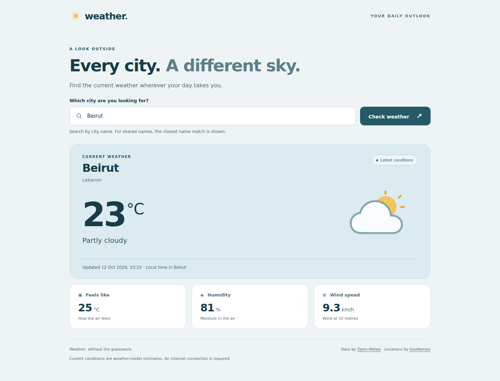

# Weather Dashboard - Assignment 4

A responsive dashboard that fetches current weather for a user-entered city. Built with plain HTML, CSS and JavaScript, without a framework or build step.

## Run the app

1. Extract the ZIP completely. Do not run it from inside the archive.
2. Open `index.html` in a current version of Chrome, Edge, Firefox or Safari.
3. Enter a city, such as **Beirut**, **Paris** or **Tokyo**, and click **Check weather** or press **Enter**.
4. Keep an internet connection available so the app can reach the weather API.

If your browser restricts requests from local files, use VS Code's Live Server extension, or serve this folder using Python:

```sh
python -m http.server 8000
```

On Windows, `py -m http.server 8000` also works when the Python launcher is installed. Visit `http://localhost:8000`. No `npm install` is required to run the app.

## API choice and API keys

This project uses **Open-Meteo**, confirmed by the student as an instructor-approved equivalent for this assignment. Its public non-commercial API does **not** require an API key. There is no key to obtain, paste or commit, and no `.env` file is needed to run this version.

The `.gitignore` still excludes `.env`, local environment files and `config.local.js` so credentials are not accidentally added if the project is extended. A private paid key should be kept on a server; putting it in browser JavaScript would expose it to visitors even when it is ignored by Git.

The two requests are:

1. `https://geocoding-api.open-meteo.com/v1/search`: resolve the typed city name into coordinates. The first ranked name match is used; the returned region and country are displayed so the selected location can be checked. For ambiguous names, use the returned location to confirm the intended city.
2. `https://api.open-meteo.com/v1/forecast`: fetch `temperature_2m`, `relative_humidity_2m`, `apparent_temperature`, `weather_code`, `wind_speed_10m` and `is_day` using those coordinates.

Units are explicitly requested as Celsius and km/h. `timezone=auto` returns city-local timestamps. Current conditions are weather-model estimates, rather than a claim of a nearby station's direct measurement. No weather values are hardcoded into the application.

Official references:

- [Weather API documentation and WMO weather codes](https://open-meteo.com/en/docs)
- [Geocoding API documentation](https://open-meteo.com/en/docs/geocoding-api)
- [Open-Meteo terms and attribution](https://open-meteo.com/en/terms)
- [GeoNames](https://www.geonames.org/)

## Features matched to the rubric

| Criterion | Points | Implementation |
| --- | ---: | --- |
| API integration and data fetching | 25 | Real city lookup followed by current weather; `fetch` with `async`/`await`; validated JSON responses. |
| Loading and error states | 20 | Visible spinner, disabled controls, clear input/city/network/timeout/HTTP/rate-limit errors, and retry after failure. |
| Dynamic rendering | 20 | Temperature, description, WMO-based icon, feels-like temperature, humidity, wind and update time all come from the selected city's response. |
| UI and responsiveness | 15 | Responsive layout, local SVG icons, readable contrast, keyboard submission, focus indicators, screen-reader announcements and reduced-motion support. |
| Code quality | 20 | Separate HTML/CSS/JS, named functions, `try`/`catch`/`finally`, explicit non-200 handling, one 15-second deadline, safe `textContent`, and no API secrets. |

This table maps implemented work to the criteria; it does not guarantee a grade.

## Project structure

```text
weather-dashboard/
  index.html                 Page structure and accessible form
  styles.css                 Desktop/mobile styling
  app.js                     Validation, API requests and result rendering
  assets/icons/              Local SVG weather icons
  screenshots/               Submitted screenshots with live Beirut data
  tests/browser-checks.cjs    Optional automated browser checks (synthetic fixtures)
  TESTING.md                 Test results and manual checklist
  package.json               Optional testing dependency; not used by the app
  README.md
  .gitignore
```

## Required screenshot

These images were captured from the running dashboard using freshly fetched weather for Beirut. The test environment blocks Chromium’s direct HTTPS transport, so the real API responses were downloaded over HTTPS and forwarded to the browser for screenshot capture. They show a point-in-time response; values will change in later searches. Automated tests use separate, explicitly synthetic data.



[View the mobile screenshot](screenshots/mobile-beirut.png).

## Three Git commits

The ZIP includes an actual local Git repository with exactly three commits on `main`:

1. `Build responsive weather dashboard layout and local icons`
2. `Integrate live city weather with loading, validation and network error handling`
3. `Verify browser behavior and add screenshots and submission documentation`

The commits were created during this project build. Check the history after extracting:

```sh
git log --oneline --reverse
```

## Submit to GitHub

The assignment requires **both** a GitHub repository link and the zipped project folder. The ZIP preserves the three local commits, but a GitHub URL must be created in your own account.

1. Create an **empty** repository on GitHub. Do not initialize it with a README, license or `.gitignore`.
2. Open a terminal inside the extracted `weather-dashboard` folder. Do not run `git init` again.
3. Replace the example URL below with your actual repository URL and run:

```sh
git remote add origin https://github.com/YOUR-USERNAME/YOUR-REPOSITORY.git
git push -u origin main
```

4. Submit that repository link and the ZIP. The screenshots are already in `screenshots/` and linked above.

Uploading only individual files through the GitHub website will not preserve the local three-commit history. Use `git push`.

## Optional automated verification

Only developers running the tests need Node.js and Playwright:

```sh
npm install
npx playwright install chromium
npm test
```

The script starts and stops its own local server. Requests are intercepted with synthetic fixtures to test successes, failures and responsiveness without consuming API quota. See `TESTING.md` for details. The browser app itself does not import test data or require these packages.
